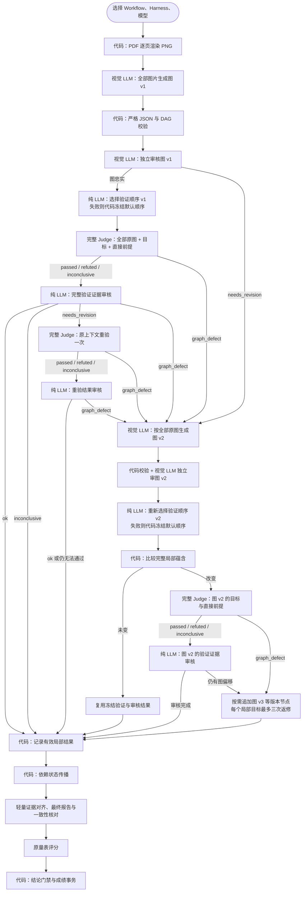
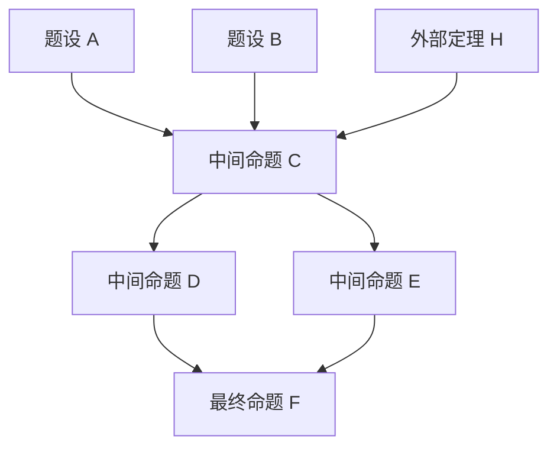

# FaithSieve 书面证明评测

FaithSieve 支持 Workflow 和 Skill，启动弹窗默认 Workflow，可以选择执行方式、Harness 和模型，各选择器复用既有样式与名称解析的图标。Workflow 由 Python 编排，使用站内通用 Judge；Skill 由主 Judge 加载 `skills/faithsieve/` 执行相同数学职责。题目与提交详情页可启动单条或批量评测，批量只取每个用户名下 ID 最大的提交。原稿按图片传递，需要已配置完整价格的全模态模型。无需阿里云 Agent API 或额外密钥模块。

管理员侧边栏「Faith Sieve」对应 `/admin/faithsieve`；详情 `/admin/faithsieve/<attempt_id>` 展示用户原始 PDF、实际执行 DAG 和数学命题依赖图。执行 DAG 来自持久 checkpoint 与关联 Judge，数学图来自 `faithsieve-work/tree.json`。两者分开显示，节点可拖动、缩放并按需展开。活动评测自动刷新；关联 Judge 会话保持只读。读取入口只返回允许的数学工件，不公开密钥、完整请求或内部文件，也不触发评测。

数学命题 DAG（schema v2/v3）使用 [ELK Layered](https://eclipse.dev/elk/reference/algorithms/org-eclipse-elk-layered.html) 按前提到结论自上而下分层，保留全部真实依赖与跨层边路径。布局引擎按需异步加载；缩放、节点拖动和选择详情沿用现有交互。历史 schema v1 状态树保留原布局。

列表右侧预览和详情页右上角显示本次评测费用，沿用全站配置中的人民币 Token 单价。Workflow 的直接模型请求、JSON 修复与重试逐次记录调用时的单价和实际用量；通用 Judge 与 Skill 读取已有会话账本。恢复检查点不重复计费，复用其他任务的结果不转移其费用。活动任务随详情刷新累计；历史缺失记录只显示已记录费用，未知费用显示 `—`，缓存用量不完整导致的估算保留标记，不按当前单价补造旧费用。

## 当前流程

新任务直接执行三个数学阶段：全部原稿图片构图、对照全部图片独立审图、挑选局部节点完整验证。PDF 仅由代码逐页渲染为 PNG；不向模型传 PDF，不提取文本或使用 OCR。没有原稿整理、步骤拆分、引文位置链或局部摘录。

1. **图片构图**：一次视觉 LLM 请求读取题面及全部 PNG，生成完整命题 DAG。代码校验 JSON 与无环结构。
2. **独立审图**：另一视觉 LLM 请求直接核对题面、全部 PNG 和 DAG，检查条件、域、量词、共享参数、见证、直接依赖及目标覆盖。图自身失真可修订，作者原错忠实保留。最多三次修订与独立复审。
3. **完整局部验证**：先用一次纯 LLM 请求安排目标依赖闭包内 claim 的验证顺序，优先关键实质推理；随后每个选定 claim 一个独立通用 Judge，接收全部原稿图片、题面、本节点完整 statement 和全部直接前驱完整 statements。Agent 自主选择数值、符号计算、其他可靠方法或 Lean，搜索工具、写代码、执行并迭代完成完整局部蕴含。没有检查对象、形式化、语义审计、证明搜索或编译子 Agent。Judge 返回 passed/refuted/inconclusive 后，由一次独立纯 LLM 请求核对同一个目标、条件、量词和完整验证报告；这次请求不搜索、不编译，也不重新证明。

图片在局部任务中用于核对作者的实际数学意图和证明方法。数学假设只能来自列明直接前驱和目标自身的局部条件；全局定义和假设须作为 given 登记并直接连接至实际使用的节点，不能从题面、祖先或其他分支隐形继承。新运行把实际使用的实质性外部数学结果单独登记为 external 前置结论，给出完整陈述、全部适用条件、量词和参数依赖，并连接至使用节点。独立审图核对其可靠已有结果身份及陈述后作为可信输入，不派额外验证 Agent；应用条件是否满足仍由当前 claim 验证。仅允许不改变命题含义的记号调整，必须保留完整条件、量词和绑定关系。

局部 Judge 或证据审核发现可确认的原稿与图差异时，返回 `graph_defect` 和结构化诊断。编排保存旧图、诊断及冻结结果，重新对照全部图片构图并独立审图；只有本节点 statement 或全部直接前提实际改变的局部蕴含才重新验证，未变的蕴含复用原冻结结果，再由代码重算建立状态。新运行按局部目标分别允许三次返修，不同节点不共用额度；同一完整上下文再次出现、修订没有实质变化或返回旧的缺陷上下文时立即停止。已失效的旧图验证不能认证新图。作者原本的证明缺口忠实保留，不借修图补成正确证明。

证据审核 `needs_revision` 时，保持同一目标和直接前提，将具体核对意见交给一个完整 Judge 重验一次。第二次仍未通过审核则该节点记为 inconclusive，并保留原始 `agent_status` 与审核结果；证据未覆盖完整局部蕴含时不能记为 passed。证据审核本身发现图偏移时走修图分支，不能将构图错误算作作者的数学错误。

`node-selector` 只给出目标依赖闭包内 claim 的完整排列，不认证命题、不改变图或直接前提，也不跳过判正确所需的节点。每次修图并独立审图通过后重新选择顺序；排序失败则冻结原稳定逆拓扑顺序作为回退，继续验证。局部 Judge 不接收排序理由、流程位置或下游用途。无关分支可以不验证；关键相关局部反驳须通过证据审核后才可结束，其余节点如实显示 not_checked，不做连续首错前缀补查。

正常 Workflow 验证 n 个 claim 就调用 n 个通用 Judge；数值与 Lean 都由该节点同一个 Judge 完成，没有原稿整理 Judge，也不拆成多次 Lean Agent 调用。选择验证顺序增加一次纯 LLM 请求，每个 passed/refuted/inconclusive 后的证据审核也是一次纯 LLM 请求，均不计为通用 Agent。需要修图时仅增加实际改变的局部蕴含调用；证据审核要求返修时，每个局部蕴含至多增加一次完整 Judge 重验。视觉构图、审图、排序、证据审核、轻量汇总和评分均不计入通用 Judge 数。

主机随后传播依赖建立状态，轻量对齐已有证据、综合报告并核对结论一致性，沿用原 0–5 分量表。节点状态、目标阻塞和可靠反证索引由代码依据实际 Judge 记录生成；模型的证据说明不能重算或覆盖这些状态。汇总不再重新转述原稿或开展另一套数学验证。完整未知结果可以任务完成而数学 verdict 为 `inconclusive`，继续形成报告与评分；端点故障和工具任务失败属于执行问题。



## 命题 DAG 与局部责任

当前图顶层精确为 `schema_version:3`、`nodes`、`edges`、`target_ids`、`ambiguities`。每个节点只有 `id`、`kind`、`label`、`statement`，每条边只有 `id`、`from`、`to`。不保存来源类别、步骤 ID、引文或位置，不使用状态继承、Γ、目标快照或状态转移字段。

- `given` 是题面明确给出的事实或定义，无入边，经独立审图通过后才初始可信。全局定义和假设必须连接至实际使用它们的 claim；只在图中存在而没有直接入边不能隐形继承。作者断言、选择的对象、局部假设或题目待证目标不能变成 given。
- `claim` 是作者实际中间命题或最终结论，无前驱时也必须证明。statement 完整表达域、量词、局部条件、常数依赖及已选见证，不能只是“由此可得”等动作或编号指代。
- `external` 是实际使用的已有外部定理，完整陈述其对象、条件、量词和常数依赖，经独立审图核对后可信。无入边、不能是目标；外部定理的应用仍是需要验证的 claim。
- 所有入边联合构成前提。共享前提使用同一节点，允许多根、多父、共享前驱和独立分支。不同对象、见证或条件下的同形公式不能无依据合并。
- `target_ids` 只指向 claim，非空且无重复。独立审图用 `target_coverage=matched|missing|inconclusive` 核对作者目标是否完整覆盖原题；作者弱化或改变目标时保留真实命题，不替作者修正。

节点 ID 为 N 加正整数，边 ID 为 D 加正整数，各自唯一、不要求连续。引用必须存在，无重边、自环或环。既有工件大小、字符串与数组安全限制继续生效；这些是输入和工件安全界限，不是模型生成额度。模型输出上限只使用全站节点的 `max_output_tokens`，FaithSieve 不降低额度。

例如 C 同时使用 A、B 和外部定理 H，D、E 又复用 C：



C 的局部责任是 `A ∧ B ∧ H ⇒ C`，F 是 `D ∧ E ⇒ F`。Lean 可以为这些列明前提使用 sorry，当前 C 或 F 的推导须完整。参数与同一见证在整个联合蕴含中共同绑定，原命题内部量词保持其自身范围。局部假设封装为完整条件命题，不能裸放成全局事实。前驱尚未建立，不等于该局部蕴含不成立；目标单独为假，也不构成局部反驳。

`passed` 需要完整忠实蕴含成立的充分证据；`refuted` 需要满足全部直接前提、域与作用域而目标失败的可靠证据，或精确否定的完整证明。可确认的构图失真为 `graph_defect`，触发独立修图，不计入数学反证；其余情况是 `inconclusive`。报告须说明证据实际支持的范围，不能将未决定的内容写成已验证结论。Agent 自主选工具，不要求固定 SymPy 表达式协议，也不由编排器覆盖其数值判断。

Lean 只形式化当前完整局部步骤。全部列明前置结论及外部结果允许作为假设参数或写成 `by sorry` 声明，跳过重证；报告逐项给出完整 Lean 类型和对应直接前驱 ID。当前 FaithSieveProof 目标及非前置辅助推导必须完整证明，不能将额外条件、未登记引理或定义用 sorry 补齐。正常的前置 sorry 编译警告不算失败，但编译成功也不能替代完整目标和占位范围审核。前置 claim 的占位不使该节点已成立，全图仍要求它各自验证通过。编译由代码工具执行，不单派 Agent，不核查版本号或 commit。

## 证据传播与结果

`faithsieve-work/node-verification.json` 保存完整图、全部节点的有效局部结果、主机重算的依赖状态、目标集合及覆盖状态。原始 Judge 的 `agent_status`、证据审核状态及报告另行保留；未通过完整命题审核的 passed/refuted 不进入有效数学账本。审图通过的 given 和已核对外部定理 external 初始建立，local_status 分别为 given、external；claim 必须有效局部 passed 且全部直接前驱已建立才 established。局部 passed 但前驱未建立为 blocked；refuted/inconclusive 为 not_established；未检查为 not_checked。修图后按当前图重新传播，即使节点的局部蕴含不变，其前提的建立状态也会重新计算。局部反驳不传播成后继命题为假，也不能自动说明原题定理为假。

正确必须作者目标覆盖为 matched 且全部 target 已建立，目标依赖闭包完成验证；无关 claim 可不验证。关键相关局部反驳出现后可以判错并结束，其余未检查节点保留 not_checked。判错须有目标依赖闭包内可靠的局部 refuted，说明对作者证明的实际影响，无关分支不能单独将已建立目标判错。汇总器不改变局部 Agent 的 verdict，不能用自然语言怀疑、图偏移、超时或搜索失败充当反证。

最终结果只有 `verdict`、`score`、`comment`，中文意见说明决定性推理、关键缺口、证据与不确定性；2/3 分仍须说明主证明骨架及修复路线。可靠成绩、提交状态和评测完成状态在同一事务保存，执行失败与 `inconclusive` 不覆盖人工成绩。

## 实现与回传

新角色资源位于 `backend/oj_modules/faithsieve/image_prompts/`，Skill 镜像位于 `skills/faithsieve/references/image-agents/`。视觉构图和审核直接接收原图；局部 Judge 接收全部 PNG、完整直接前提与目标，不经数学转述链。`verification-auditor` 接收相同原图与局部蕴含、Judge 的完整报告，只核对证据覆盖，不另行搜索或证明。

新图片 Workflow 在请求中冻结 `local_diagnostic_version:1`。局部验证结果精确为 `status`、`artifact`、`report`、`diagnostics`；`graph_defect` 时 diagnostics 非空，其余数学状态必须为 []。每条诊断精确为 `kind`、`affected_node_ids`、`reason`，kind 只取 `statement_mismatch`、`missing_premise`、`quantifier_drift`、`binding_mismatch`。验证证据审核使用同样四字段，status 为 `ok|needs_revision|graph_defect|inconclusive`。图修订与诊断保存为独立工件，旧版本及原 Judge 结果保留用于审计，不覆盖冻结 checkpoint。

新运行另冻结 `result_projection_version:1`：已声明的必需 result 字段仍严格校验，仅忽略未声明的附加 result 元数据，并原样保存在私有 checkpoint。最终评分同样只保留 `verdict`、`score`、`comment` 原值，继续严格校验已批准结论和原量表。缺字段、错误状态、DAG、diagnostics、工件与数学语义均不放宽；没有该标记的历史请求保持原行为。

新排序协议冻结 `node_selection_version:1`，顺序工件为 `faithsieve-work/node-selection.json`；页面显示「选择验证顺序」，合法回退显示「使用默认顺序」。该模式还为构图、审图、局部验证和证据审核追加 `source-conditions.md`，逐项核对实际使用的条件与定义来自完整直接前驱或目标局部条件；未直接连接的全局 given 不算已有前提。没有该标记的历史运行继续使用原稳定逆拓扑顺序及原提示词，恢复时不补派排序请求。

新运行冻结 `external_results_version:1`，各角色追加 `external-results.md` 的公共边界及同名职责。schema v3 增加 kind=external，保持四字段节点，无入边且不能作为 target。前端以虚线圆节点区分外部结果，详情展示完整陈述。局部发现需要而未登记的可核对外部定理时走 missing_premise 修图及独立审图，再验证受影响步骤；不能把作者未证桥梁冒充外部结果。无该标记的历史运行保持原图类别及 Lean 合同，旧版整文件占位门禁不放宽。

新运行另冻结 `verification_audit_version:1`：无结论报告也进行一次独立核对，区分忠实命题的证据不足与原稿已有条件被图遗漏。后一种情况返回 `graph_defect` 并修图；审核 `ok` 只保留原 `inconclusive`，不能升级为通过或反驳。局部 Judge 发现明确图遗漏时须先返回结构化诊断，不借题面补条件后继续数值探索。没有该标记的历史请求保持原审核范围与调用身份。

新运行同时冻结 `verification_method_version:1`，核对无结论理由是否误解任务、所用外部结果是否经过核实，以及证据是否足以支持报告结论。必要的已有外部结果缺少登记时，应按 `external_results_version:1` 返回缺失前提诊断，补图后继续验证。可确认的方法误解返回 `needs_revision`，由同一完整局部任务自主补充验证；仍缺充分证据时可以保持无结论。历史请求的提示词逐字保留；在新续接工作区，可通过 `image-verification-method-policy` 指定一份实际完成的无结论 Judge 报告作为边界，从下一次真实报告审核起启用新规则，保留此前全部请求和结果，不预置审核结论。

返修次数另由宿主 checkpoint `image-graph-repair-policy` 冻结，不加入模型角色请求，也不展示为 Workflow 阶段。没有该记录的已开始前缀保持原全图三轮规则；显式续接到新工作区时可保留全部原数学请求，单独冻结新的宿主策略。计数与完整上下文历史从角色前缀重放重建，不使用文件指纹。

独立看图复核发现遗漏时，可在新续接工作区冻结 `image-graph-context-revision` 审图指令。它必须指定已完整完成的角色前缀、受影响节点及复核意见；代码先核对前缀，再于下一项新 Judge 之前让真实构图和审图请求读取全部 PNG。意见不是数学判定，不能代替原图审核；指定节点没有实质修订就停止。修图后重选验证顺序，只重验完整局部上下文变化的节点。两份宿主记录均不传给局部 Judge，不生成原稿转录或引文。

普通模型结果在同次请求中通过严格 JSON mode 或 `faithsieve_result` 参数回传，按既有端点协议与 Thinking 配置选择。结果函数只接收结构化数据，不执行工具或开启额外对话。角色结果、工件与控制字段仍严格校验；输出截断不发布产物。

`node_selection_version:1` 模式中，唯一合法结果函数附带的普通正文不进入工件或证据；自动工具选择没有调用函数时，也可读取完整纯 JSON 正文。强制工具调用不改用正文，错误函数或多个函数不能改用正文，两个通道不合并。所有结果仍经过同样的结构与数学工件校验，历史请求保留原严格通道行为。

该模式下，纯 LLM 角色的非流式请求若完整返回唯一 `faithsieve_result`、参数恰为 `{}`，可在原角色内尝试一次严格流式回传。原提示词、全部图片、结果 schema、思考强度和端点配置保持冻结，只改变传输方式，不补齐缺失结果。重试及其实际回传单独保存在私有 checkpoint；重入继续该请求，重试失败后不再次生成原角色。截断、多个函数、错误函数或非空的错误结果不进入这个回退。

完整响应仅有 JSON 语法问题时，使用一次单独 LLM 请求修复格式，复用冻结端点和全站输出配置；只提供原始响应与解析错误，不重新给数学任务或图片。修复必须保持字符串、数字、状态与结构归属，随后仍通过原结构校验。新模式每个逻辑角色至多一次专门格式修复，即使已因回传通道问题重试过该角色；修复失败后不再次生成该角色或整项任务。截断、数学漂移、重复字段、非标准常量或缺工件不能通过格式修复补全。

每次请求冻结实际输入、调用选项、模型与 Harness，续跑复用同一 checkpoint 和 Judge 身份，不使用 hash，不重复已完成任务。思考与纯 LLM 强度沿用全站设置及私有运行快照；不改变原生 Judge 的 Harness 强度。模型端点故障保存安全执行分类，不生成数学结果，失败检查点不自动重发。

通用 Judge 由既有 `submit_judge_turn` 创建 `task_kind=judge`、`judge_kind=faithsieve` 会话，人工入口只读，关闭旧 skill 投影以免递归运行整套评测。输入和冻结身份在读取结果时重新核对。通用镜像预装 Lean、mathlib 源码与编译缓存、SymPy，调用时直接使用，不下载环境。独立 Docker 工具禁网、只读根文件系统，仅 workspace 可写；工具失败或清理不确定时不认证结果。

## 持久队列与历史

`faithsieve_grading_runs` 保存 workflow/skill、排队、运行和终态。两种方式共享名额并按提交去重，普通 celery 队列负责短调度，编排与 Judge 使用 agent 队列。Judge 未完成时保存 checkpoint 并交回 Celery 重试，释放 worker 与执行锁；重入读取同一任务而不重新派发。整体时限从领取名额起累计两小时，包含排队与等待，不在续跑时重置；保存成绩再次检查数据库时钟，超时取消关联待执行任务。

通用职责只描述输入、完整验证责任、证据要求与回传协议，不列举具体学科、数学对象或题型示例。当前题目需要的条件、对象和已有结果由题面、原稿及已审核 DAG 提供。

历史 v1 状态树、v2 依赖图及 Markdown 工件保留原语义与原文，只读展示，不推断或补写成 v3。旧 runtime `prompts/`、`workflow_source.md` 和 Skill 角色保留旧流程契约，正文同样使用通用职责。v2/v3 已有角色调用重放保存的完整提示词，消息正文、题面、节点、直接前提、图片、模型配置和协议字段仍逐项严格核对；模板更新不改写冻结请求，尚未发出的调用使用当前模板。已冻结但没有 `local_diagnostic_version` 的 v3 请求继续使用旧角色协议，局部结果保留 status/artifact/report 三字段，不补派新证据审核，也不切换为新诊断协议。新任务不走原稿整理、拆分或多角色 Lean 链。

管理员显式恢复允许仍在整体时限内、满足原资格的端点失败任务，以及旧 600 秒时限安全结束且没有结果的首次图片局部 Judge。后者只在原会话、原生 Harness session 与工作区续聊一次，执行时限取原整体剩余时间；新局部任务直接使用整体剩余时间。该授权节点完成后，后续重入继续重放缓存；若编排中断在另一个已完成但尚未回读的 Judge，可严格核对其原输入和结果后复用同一授权重投编排，不重新派发 Judge。原输入、模型、Harness 与已完成请求不得改变。详情页只做只读预检；授权入口保留失败历史，不能借恢复重做完成阶段或切换旧任务语义。普通 LLM 响应返回后而 checkpoint 尚未发布时进程硬崩溃，仍可能再次请求。

## 本机运行


当前本机环境复用项目 `.venv`、前端构建产物、本机 MySQL 和 `faithsieve-check` Colima 中已预装 Lean/mathlib 的 lite 镜像，不运行生产部署脚本。Web、独立 Redis、普通 Celery worker、Agent worker 和日志采集器统一由独立 Supervisor 管理。

本地 Judge 默认内存限额为 5 GiB，显式 `AGENT_JUDGE_MEM_LIMIT` 可覆盖；当前专用虚拟机分配 6 GiB 内存。此前 4 GiB 限额在完整 mathlib 导入时持续触发内存回收，拖慢编译。这个本地调整不修改生产默认，也不增加磁盘容量。

```bash
.venv/bin/python scripts/local_faithsieve.py start
.venv/bin/python scripts/local_faithsieve.py status
.venv/bin/python scripts/local_faithsieve.py stop
```

网页地址为 `http://127.0.0.1:2025`。管理员登录信息保存在权限为 `0600` 的 `tmp/local-faithsieve/access.json`；脚本初始化的样例题为 `/problems/1`，正确解答和含错误的解答分别为 `/submissions/1`、`/submissions/2`。当前测试环境还另行导入了独立样例题 `/problems/3` 和解答 `/submissions/4`，它们不由启动脚本初始化。题目及提交详情页可选择 Workflow / Skill、Harness 和模型；任务列表位于 `/admin/faithsieve`。样例初始化不自动触发评测；实际模型请求由网页启动操作触发。

隔离数据库固定为本机 `faithsieve_local_test`，应用使用仅有该库权限的专用账号；Redis 单独监听 `127.0.0.1:6389`，使用 15 号库。模型配置是把项目 `.env` 中已授权的百炼凭据显式导入本地 MySQL，不新增应用环境变量回退。默认节点为 `qwen3.5-plus-2026-04-20`，可选 Claude Code 或 Pi；上下文限制为 128000、输出上限为 32000，价格按[官方北京最低输入阶梯](https://help.aliyun.com/zh/model-studio/qwen3-5-plus)配置输入、缓存命中、输出每百万 token 0.8、0.08、4.8 元。节点保持“未测试”，初始化不调用供应商。后续可在本地“全站配置”修改，重复启动保留已有修改。

新增上传、工作区、checkpoint、Redis 快照和轮转日志均在 `tmp/local-faithsieve/`；单项 Agent 工作区上限 1 GiB，Agent 并发初始为 1，日志每份上限 1 MiB、保留两份备份。本地入口将 GC 和日志 socket 指向隔离目录；该环境仅用于 FaithSieve，不提供 VibeHub 作品运行。停止默认同时停专用虚拟机并保留数据；若同一虚拟机还有其他运行容器，则保留虚拟机运行。

```bash
# 删除本次独立数据库、数据库账号和全部本地运行数据，保留镜像以便再次启动。
.venv/bin/python scripts/local_faithsieve.py clean

# 同时删除 FaithSieve 专用虚拟机和镜像，释放其磁盘；再次运行需重建镜像。
.venv/bin/python scripts/local_faithsieve.py clean --remove-vm
```

脚本只管理上述固定本地资源，不修改既有 `myojdb`、`myojdb_visual_test`、6379 Redis、项目其他上传目录或其他 Colima profile。初次建库及清理使用本机 MySQL root；若该账号有密码，通过进程变量 `NUMOJ_LOCAL_MYSQL_ROOT_PASSWORD` 提供，它不会进入应用进程或持久文件。
